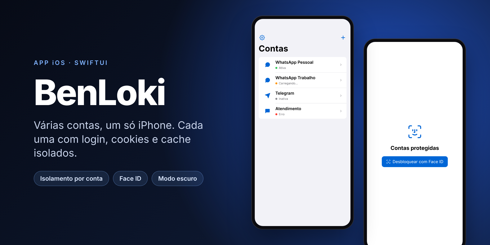
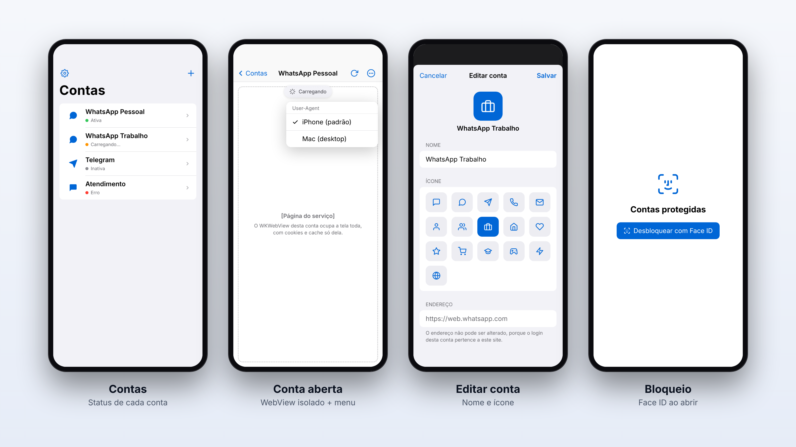
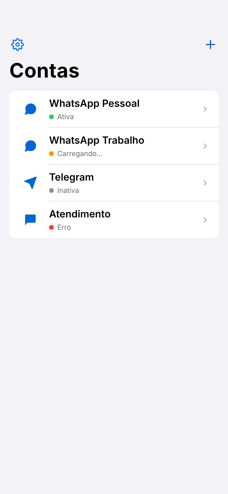
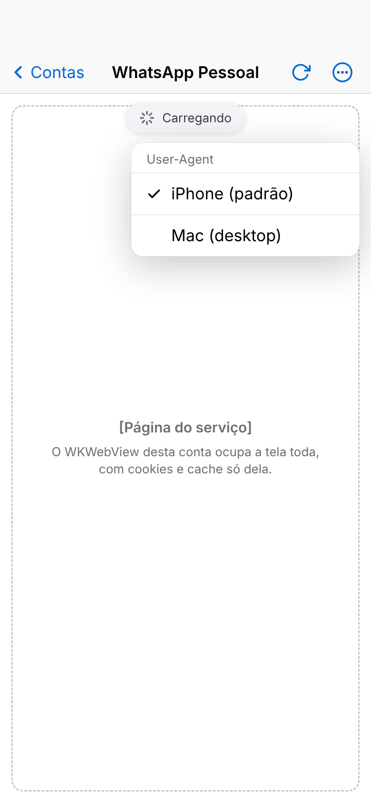
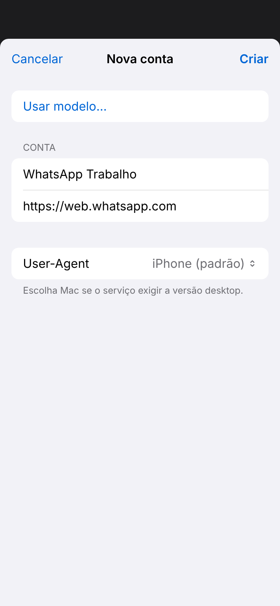
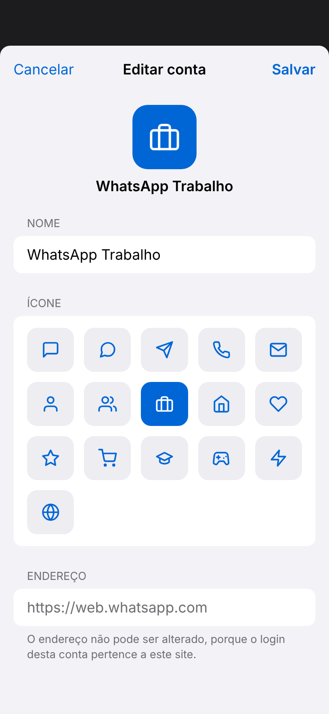
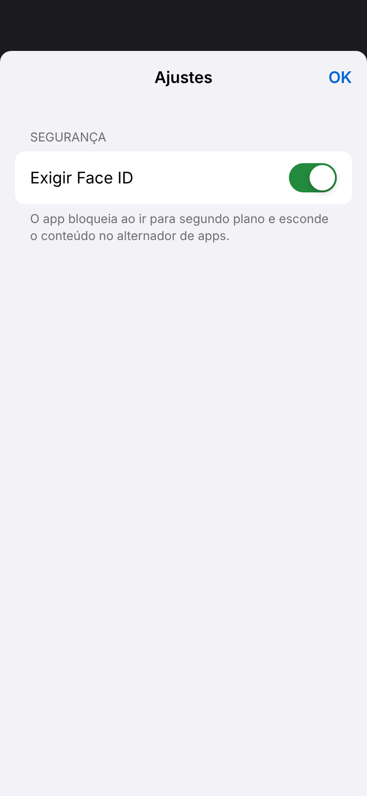
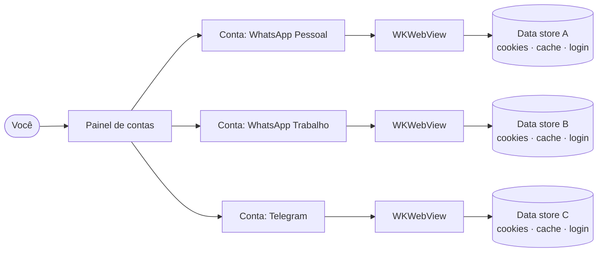

<div align="center">



<br>


**WhatsApp Web, Telegram Web e outros serviços com várias contas no mesmo iPhone,<br>cada uma com login, cookies e cache totalmente separados.**

[Recursos](#-recursos) · [Telas](#-telas) · [Como funciona](#-como-funciona) · [Começando](#-começando) · [Roadmap](#-roadmap)

</div>

---

## ✨ Recursos

<table>
<tr>
<td width="50%" valign="top">

### 🔐 Isolamento por conta
Cada conta tem seu próprio `WKWebsiteDataStore`. Cookies, `localStorage`, IndexedDB e cache nunca se misturam.

</td>
<td width="50%" valign="top">

### 🪪 Bloqueio por Face ID
O app abre bloqueado, bloqueia de novo ao sair e esconde as conversas no alternador de apps.

</td>
</tr>
<tr>
<td valign="top">

### 🎨 Nome e ícone por conta
Renomeie cada conta e escolha entre 16 ícones para identificar "Pessoal", "Trabalho" e outras de relance.

</td>
<td valign="top">

### 🔋 Leve na bateria
No máximo 2 páginas abertas em memória. Ao ir para segundo plano, tudo é liberado e o login continua salvo.

</td>
</tr>
<tr>
<td valign="top">

### 🖥️ Modo desktop
Alterne o User-Agent entre iPhone e Mac em cada conta, para serviços que exigem a versão desktop.

</td>
<td valign="top">

### 🎙️ Câmera e microfone
Áudios e chamadas funcionam, com permissão liberada **apenas** para o site da própria conta.

</td>
</tr>
</table>

## 📱 Telas

<div align="center">

</div>

<details>
<summary><b>Ver todas as telas</b></summary>
<br>

| Contas | Conta aberta | Nova conta | Editar conta |
|:---:|:---:|:---:|:---:|
|  |  |  |  |

| Ajustes | Bloqueio | Modo escuro |
|:---:|:---:|:---:|
|  |  |  |

</details>

> [!NOTE]
> As imagens são prévias fiéis aos componentes SwiftUI usados no código, renderizadas fora do simulador. No iPhone, o app usa a fonte e os ícones do sistema (SF Pro e SF Symbols).

## 🧠 Como funciona

O BenLoki **não copia nem modifica apps instalados**. O iOS isola cada app no próprio sandbox, e nenhum app consegue duplicar outro. Em vez disso, cada "conta" abre a **versão web** do serviço num navegador embutido (`WKWebView`) com um armazenamento só dela.



Para o WhatsApp, cada data store parece um navegador diferente. Por isso dá para vincular duas contas distintas como dois "aparelhos conectados".

<details>
<summary><b>Camadas da arquitetura</b></summary>
<br>

| Camada | Arquivo | Responsabilidade |
|---|---|---|
| Interface | `Views/` | Telas SwiftUI; nunca criam WebViews diretamente |
| Estado | `ViewModels/InstanceManager.swift` | Lista de contas, edição e persistência |
| Runtime | `Runtime/SessionRuntime.swift` | Quantos WebViews existem, LRU, ciclo de vida |
| Sessão | `Runtime/SessionController.swift` | Um `WKWebView` por conta, permissões, navegação |
| Isolamento | `Isolation/DataStoreProvider.swift` | Um `WKWebsiteDataStore` por conta |
| Segurança | `Security/` | Bloqueio por Face ID numa janela própria |
| Disco | `Persistence/InstanceStore.swift` | Só metadados, em JSON versionado e protegido |

</details>

## 🚀 Começando

**Requisitos:** Mac com Xcode 15 ou mais novo e [XcodeGen](https://github.com/yonaskolb/XcodeGen).

```bash
brew install xcodegen
git clone https://github.com/nanzinx/BenLoki.git
cd BenLoki
xcodegen            # gera BenLoki.xcodeproj a partir do project.yml
open BenLoki.xcodeproj
```

Em seguida:

1. Em **Signing & Capabilities**, escolha seu **Team** (uma Apple ID gratuita serve para testar no seu aparelho).
2. Troque o **Bundle Identifier** `com.exemplo.benloki` por um ID único seu.
3. Escolha um simulador ou o seu iPhone e aperte **⌘R**. Para os testes, **⌘U**.

<details>
<summary><b>Instalar no iPhone e publicar na App Store</b></summary>
<br>

**No seu iPhone (grátis):** conecte o cabo, selecione o aparelho no Xcode e aperte ⌘R. No iPhone, ative **Ajustes › Privacidade e Segurança › Modo de Desenvolvedor** e confie no seu perfil em **Ajustes › Geral › VPN e Gerenciamento de Dispositivos**. Com conta gratuita, o app expira em 7 dias.

**TestFlight / App Store:** exige o Apple Developer Program (US$ 99/ano). No Xcode, use **Product › Archive** e depois **Distribute App › App Store Connect**. No [App Store Connect](https://appstoreconnect.apple.com), adicione testadores no TestFlight ou envie para revisão.

</details>

## ⚠️ Limitações

<details>
<summary><b>O que o app não faz, e por quê</b></summary>
<br>

- **Sem notificações push:** o iOS não entrega notificações de sites dentro de apps. As mensagens chegam quando você abre a conta.
- **Sem uso em segundo plano:** o iOS suspende o app em segundos, então chamadas e conexões caem ao sair.
- **Termos de uso:** WhatsApp e Telegram restringem clientes não oficiais. Há risco de bloqueio de contas.
- **App Store:** apps de "clonagem" de contas costumam ser rejeitados (diretriz 4.3).
- **Identificação do aparelho:** o isolamento não esconde IP nem o modelo do aparelho.

</details>

## 🧭 Roadmap

- [x] Isolamento de dados por conta
- [x] Painel com status em tempo real
- [x] User-Agent mobile/desktop por conta
- [x] Bloqueio por Face ID
- [x] Editor de nome e ícone
- [ ] Tempo de tolerância para o bloqueio
- [ ] Contador de não lidas por conta
- [ ] Limite de contas conforme a memória do aparelho

## 📚 Documentação

A documentação técnica completa (camadas de isolamento, ciclo de vida, permissões e decisões de arquitetura) está em [`MultiSessionWrapper/README.md`](MultiSessionWrapper/README.md).
